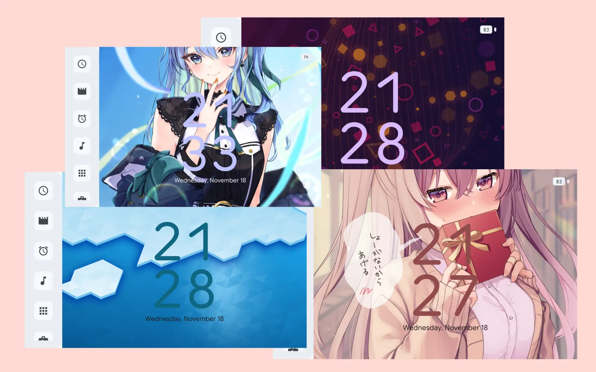
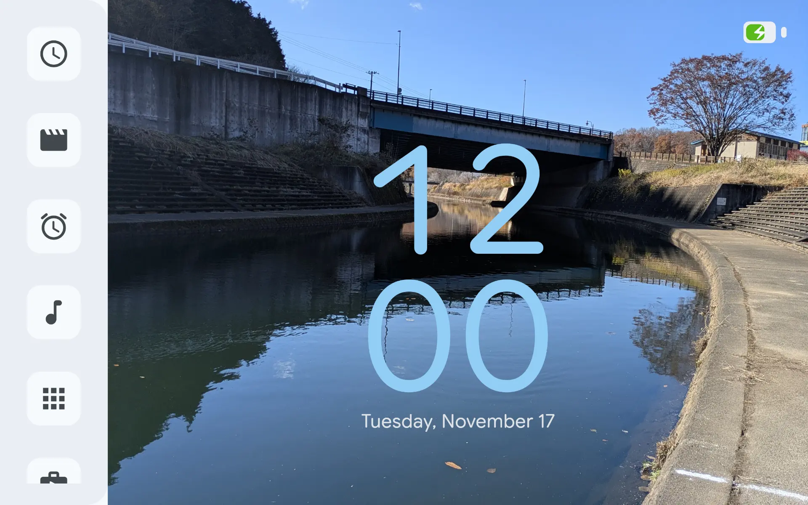
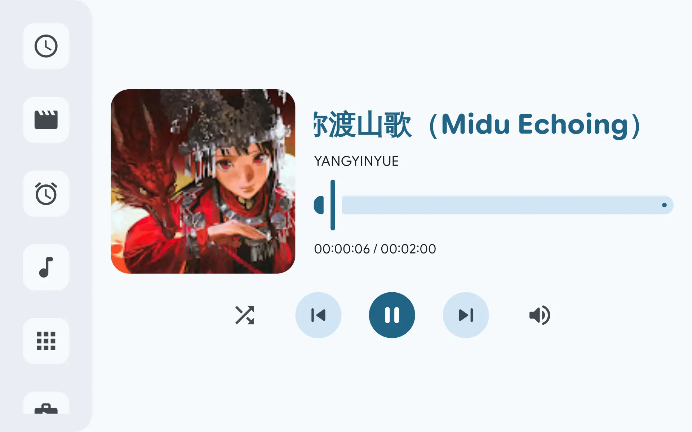
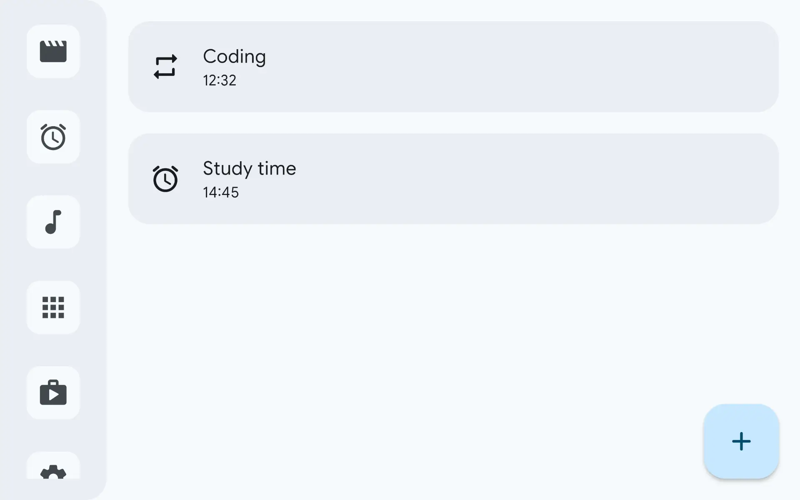
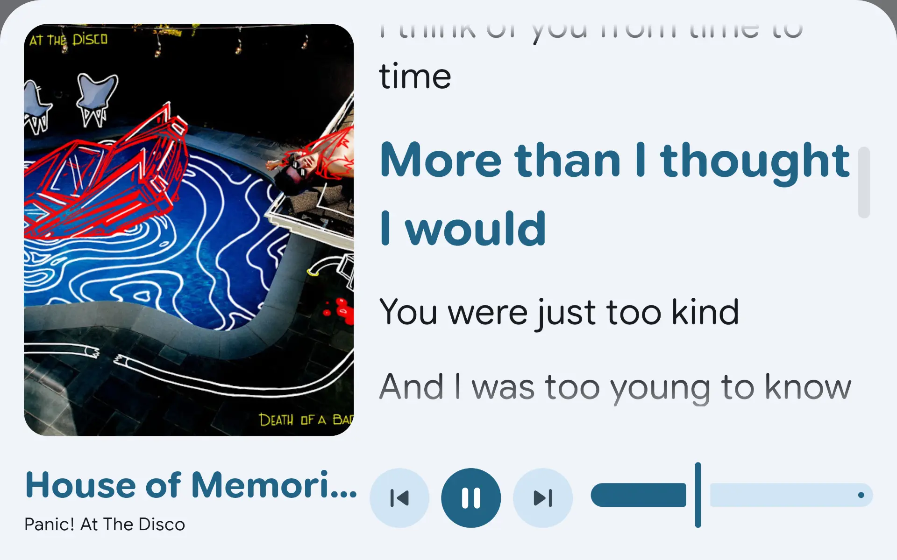
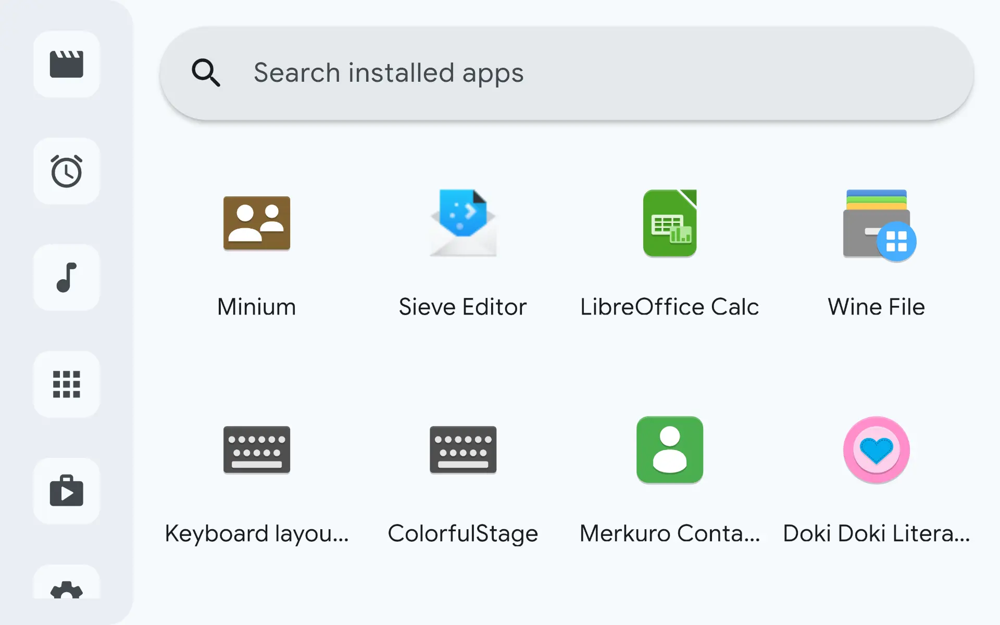
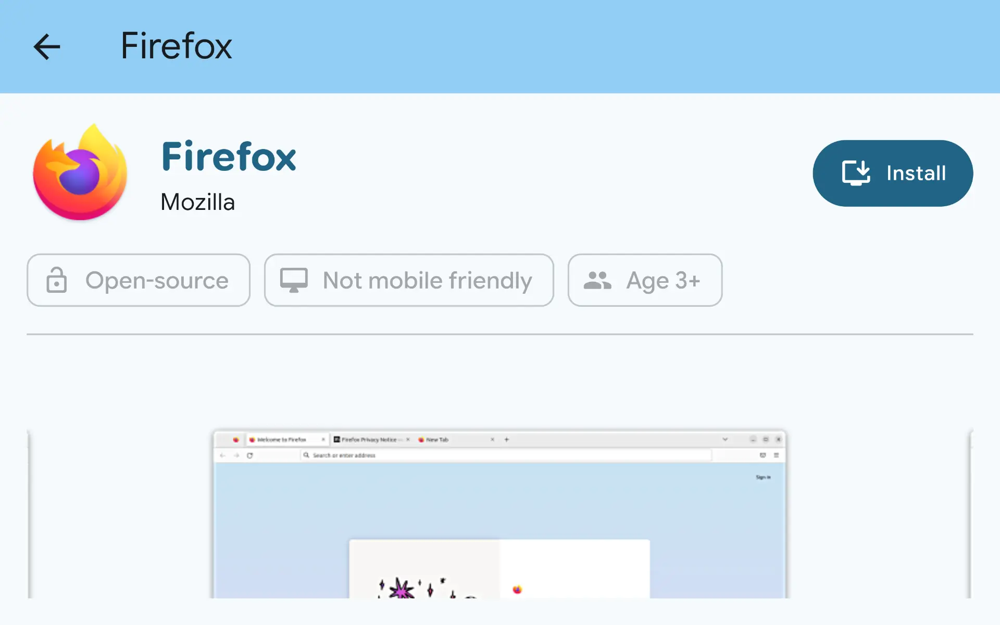

# Strontianite

[Releases](https://github.com/strontium-linux/releases/latest) · [Strontium Linux](https://strontium.ingstudios.dev) · [License](/LICENSE)



Strontianite is a Material 3 Expressive smart home OS shell inspired by Android Things.

This shell is currently a work in progress but has reached a usable state.

## Features

- Pixel UI inspired clock
- Material 3 Expressive themeing
- Beautiful animations thanks to Flutter
- Media controller for Linux and Android
- Alarms
- YouTube Music playback
- Flatpak frontend
- App launcher

## Gallery













## Contributing

Strontianite welcomes contributions! Like other projects under the Strontium Linux Project, **AI code contributions are strictly prohibited** to maintain quality and consistency.

## Building

### Prerequisites

- **Flutter SDK 3.12.2 or higher**
- **A Linux machine or an Android device**
- **Android Debug Bridge (adb)**

This is only required if you build for Android

### Run steps

1. **Run the Flutter project**

```bash
flutter run -d linux # Run to test on Linux
flutter run -d <device-id> # Run to test on Android
```

### Build steps

1. **Build for different targets**

```bash
flutter build --release linux # Build for Linux
flutter build --release apk # Build for Android
```

## License

Strontianite is licensed under the [Apache 2.0 License](/LICENSE) like our other projects.

© 2026 (ing) Studios, Strontium Linux contributors, and Ethan Lee